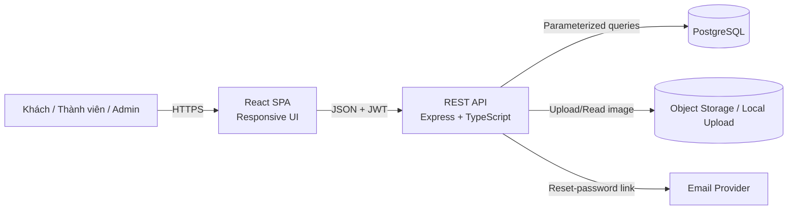
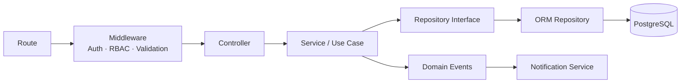
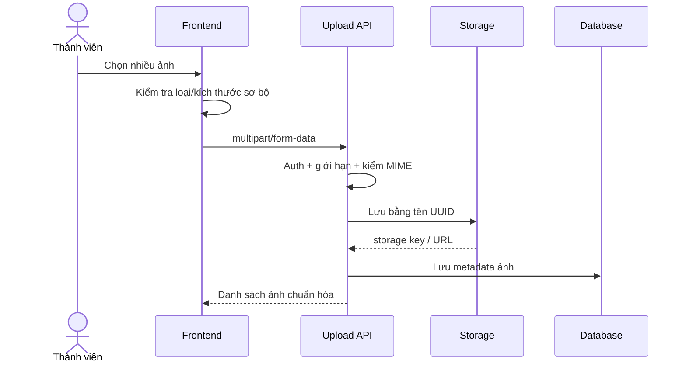

# 02. Kiến trúc hệ thống

## 1. Quyết định công nghệ đề xuất

| Lớp | Công nghệ | Lý do |
|---|---|---|
| Frontend | React + TypeScript + Vite | SPA responsive, hệ sinh thái form/query tốt, chia sẻ type dễ dàng |
| UI | Tailwind CSS + component nội bộ | Duy trì hệ màu và responsive nhất quán |
| Rich text | Tiptap hoặc tương đương | Dữ liệu có cấu trúc, mở rộng ảnh/heading/link; đầu ra vẫn phải sanitize ở server |
| Backend | Node.js + Express + TypeScript | REST rõ ràng, phù hợp MVC, dễ tách Service/Repository |
| Validation | Schema validation ở biên API | Một nguồn quy tắc cho body/query/params và lỗi nhất quán |
| Database | PostgreSQL | Quan hệ mạnh, constraint/index tốt, full-text search có lộ trình nâng cấp |
| Data access | ORM có migration và truy vấn tham số hóa | Chống SQL Injection và quản lý schema có version |
| Test | Unit + integration + API/E2E | Kiểm tra cả nghiệp vụ và hợp đồng REST |

Không khóa phiên bản thư viện ở Giai đoạn 1. Phiên bản tương thích sẽ được cố định khi khởi tạo Giai đoạn 2.

## 2. Sơ đồ container



## 3. Luồng backend



- Route ánh xạ HTTP method/path.
- Middleware xác thực, phân quyền, validation, upload limit và rate limit.
- Controller chỉ chuyển đổi HTTP request/response; không chứa truy vấn.
- Service thực thi nghiệp vụ và transaction.
- Repository đóng gói ORM, giúp unit test bằng mock và tránh lặp truy vấn.
- Event nội bộ tách tạo thông báo khỏi thao tác like/comment/follow.

## 4. Cấu trúc thư mục dự kiến

```text
project/
├─ frontend/
│  ├─ src/
│  │  ├─ app/              # router, providers, store
│  │  ├─ components/       # UI dùng chung
│  │  ├─ features/         # auth, posts, profile, comments...
│  │  ├─ pages/
│  │  ├─ services/         # HTTP client
│  │  ├─ types/
│  │  └─ utils/
│  └─ tests/
├─ backend/
│  ├─ src/
│  │  ├─ config/
│  │  ├─ common/           # errors, middleware, utils
│  │  ├─ modules/
│  │  │  ├─ auth/
│  │  │  ├─ users/
│  │  │  ├─ posts/
│  │  │  ├─ comments/
│  │  │  └─ ...
│  │  ├─ routes/
│  │  └─ server.ts
│  ├─ database/            # schema, migrations, seed
│  ├─ uploads/             # dev only, không commit nội dung upload
│  └─ tests/
├─ docs/
└─ infra/                  # deploy configuration ở Giai đoạn 10
```

Mỗi module backend dự kiến có `controller`, `service`, `repository`, `validation`, `routes`, `types` và test tương ứng. Chỉ tạo lớp abstraction khi có giá trị kiểm thử hoặc tái sử dụng; tránh lớp rỗng chỉ để “đủ pattern”.

## 5. Authentication và authorization

1. Đăng nhập thành công trả access token ngắn hạn và refresh token ngẫu nhiên.
2. Access token chứa tối thiểu `sub`, `role`, `jti`, `iat`, `exp`; không chứa dữ liệu nhạy cảm.
3. Refresh token lưu ở cookie `HttpOnly`, `Secure` tại production, `SameSite` phù hợp; database chỉ lưu hash.
4. Endpoint refresh xoay token; phát hiện tái sử dụng thì thu hồi chuỗi phiên.
5. Middleware `authenticate` xác minh chữ ký/hạn; `authorize` kiểm tra role; service vẫn kiểm tra ownership.
6. Đổi mật khẩu, khóa tài khoản và reset mật khẩu thu hồi toàn bộ refresh token đang hoạt động.

## 6. Bảo mật dữ liệu và nội dung

- Password: Argon2id với tham số cấu hình qua môi trường; không log password/token.
- SQL Injection: ORM/truy vấn tham số hóa; không nối chuỗi SQL từ input.
- XSS: sanitize HTML phía server bằng allowlist; frontend render qua component kiểm soát.
- Upload: kiểm tra MIME thực, phần mở rộng, kích thước và số lượng; tên file UUID; không dùng tên gốc làm path.
- API: validation body/query/params; payload limit; rate limit cho auth, comment và upload.
- HTTP: HTTPS, CORS allowlist, security headers, request ID; cookie refresh cần bảo vệ CSRF.
- Secret: chỉ ở biến môi trường/secret manager; cung cấp `.env.example`, không commit `.env`.

## 7. Upload ảnh



Ở local, file nằm trong thư mục upload riêng và được phục vụ có kiểm soát. Ở production, dùng object storage/CDN; database chỉ giữ storage key, URL và metadata.

## 8. Tính nhất quán và xóa dữ liệu

- Like/follow dùng unique constraint để chống ghi trùng khi request đồng thời.
- Các thao tác bài + ảnh hoặc tương tác + thông báo sử dụng transaction khi cần tính nguyên tử.
- User không xóa cứng trong MVP; khóa tài khoản giữ nguyên nội dung và lịch sử.
- Post/comment có trạng thái xóa mềm; ảnh vật lý được dọn bằng tác vụ có kiểm soát sau thời gian lưu giữ.
- Không cascade delete dữ liệu audit hoặc notification một cách mù quáng.

## 9. Chiến lược tìm kiếm

MVP dùng tìm kiếm không phân biệt hoa/thường với index phù hợp và phân trang. Khi dữ liệu tăng, nâng cấp PostgreSQL full-text/trigram mà không đổi REST contract. Không đưa Elasticsearch vào MVP vì tăng chi phí vận hành chưa cần thiết.

## 10. Deployment đích

Frontend phục vụ qua static hosting/CDN; backend chạy container riêng; PostgreSQL managed; ảnh ở object storage. Mỗi môi trường `development`, `test`, `production` có biến môi trường và database tách biệt. Chi tiết triển khai thuộc Giai đoạn 10.
