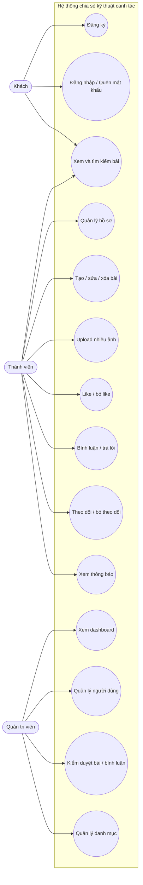
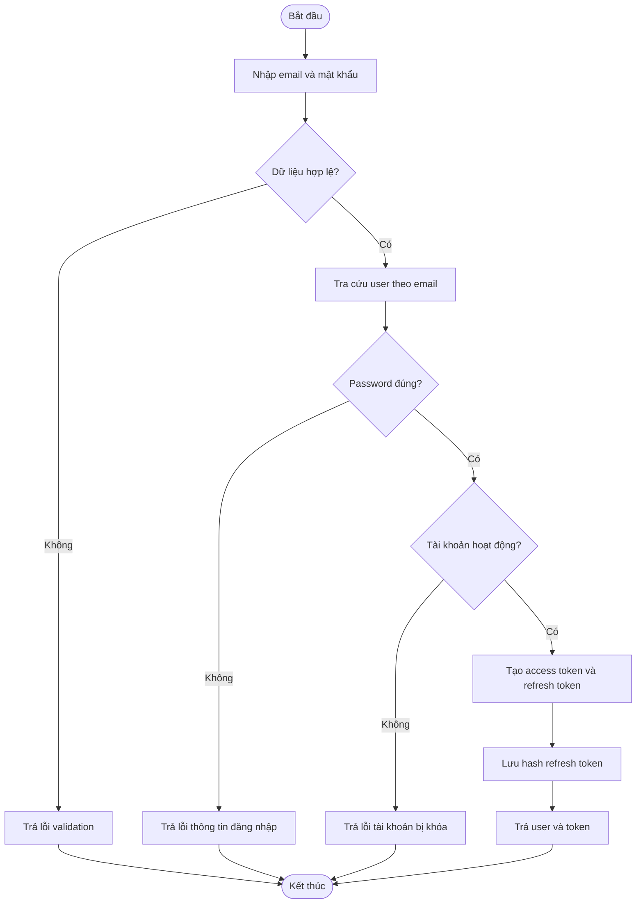
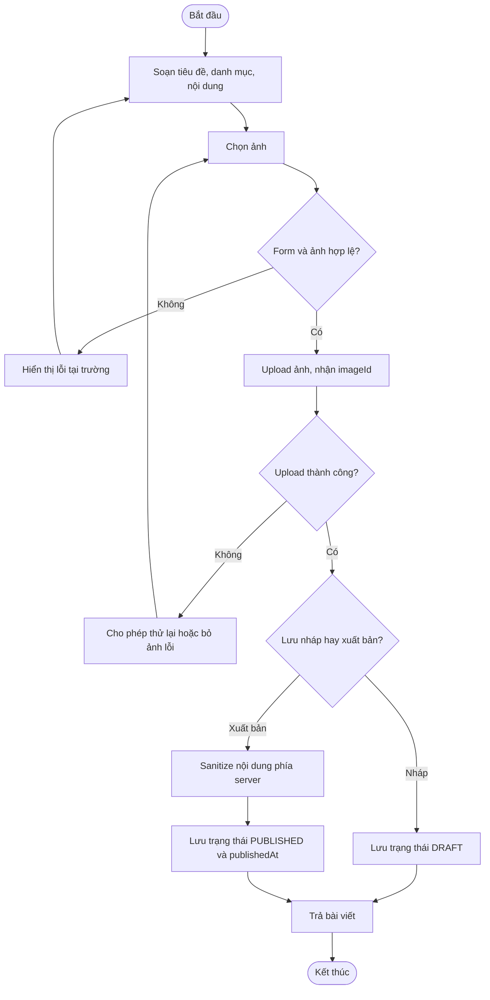
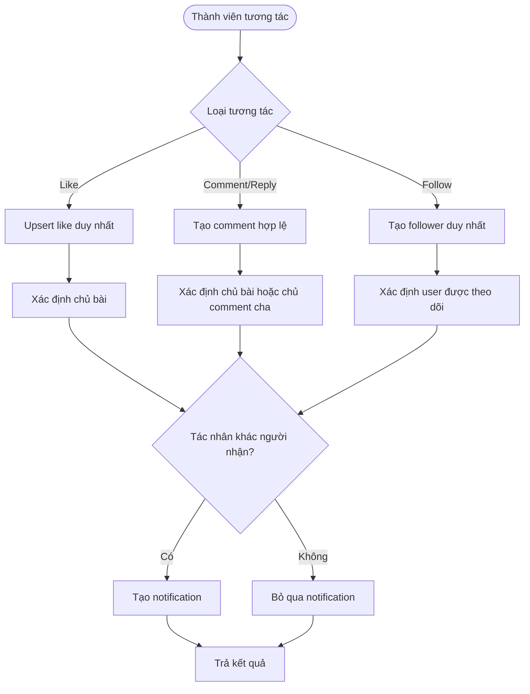
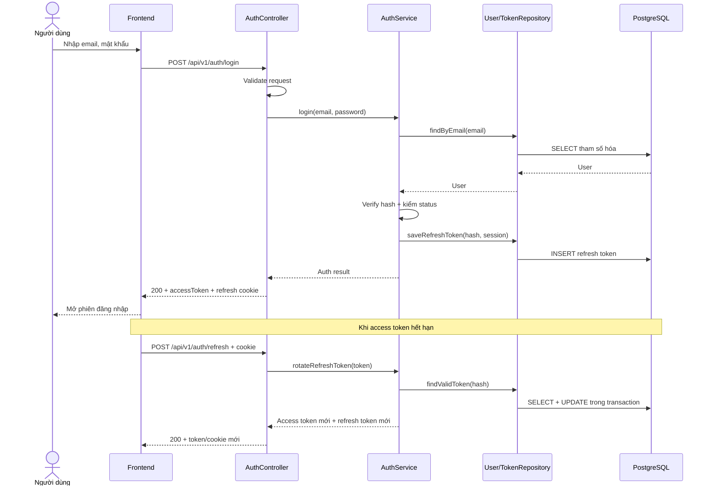
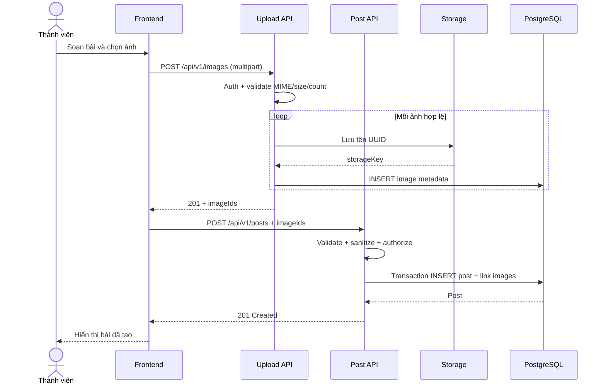
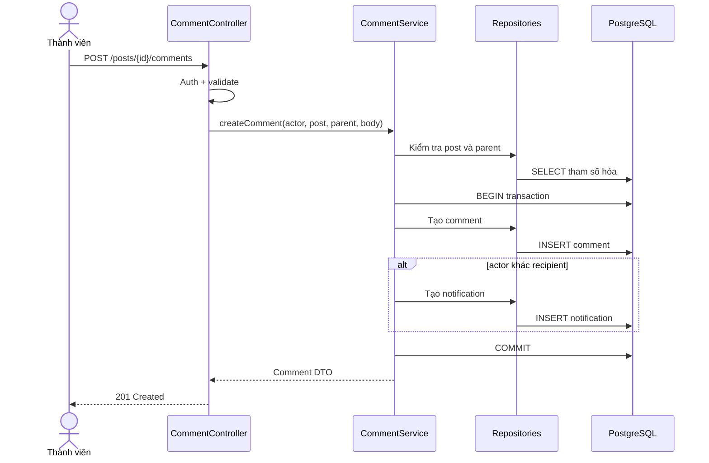
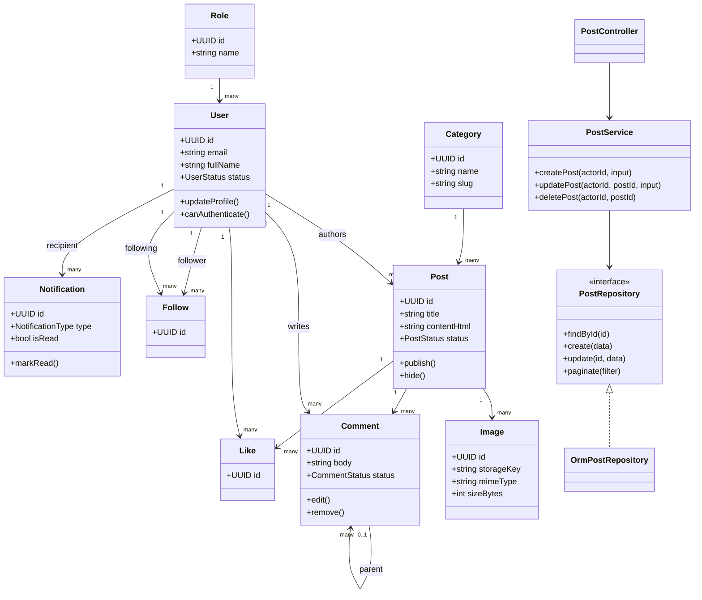

# 03. Use Case và các sơ đồ UML

## 1. Use Case tổng quan

`ADMIN` kế thừa mọi khả năng phù hợp của `MEMBER`; sơ đồ chỉ nhấn mạnh use case quản trị.

## 2. Đặc tả Use Case chính

### UC-01 – Đăng ký

| Thuộc tính | Nội dung |
|---|---|
| Tác nhân | Khách |
| Tiền điều kiện | Chưa đăng nhập |
| Luồng chính | Nhập họ tên, email, mật khẩu → hệ thống validate → kiểm tra email → hash password → tạo user role MEMBER → trả kết quả |
| Ngoại lệ | Email đã tồn tại; mật khẩu yếu; dữ liệu sai định dạng |
| Hậu điều kiện | Tài khoản `ACTIVE` được tạo; không trả `password_hash` |

### UC-02 – Đăng nhập

| Thuộc tính | Nội dung |
|---|---|
| Tác nhân | Khách |
| Tiền điều kiện | Có tài khoản |
| Luồng chính | Nhập email/mật khẩu → kiểm tra thông tin và trạng thái → tạo access/refresh token → ghi phiên |
| Ngoại lệ | Sai thông tin; tài khoản bị khóa; rate limit |
| Hậu điều kiện | Phiên đăng nhập hoạt động, refresh token chỉ lưu dạng hash |

### UC-03 – Tạo và xuất bản bài viết

| Thuộc tính | Nội dung |
|---|---|
| Tác nhân | Thành viên |
| Tiền điều kiện | Đã đăng nhập, tài khoản hoạt động, danh mục hợp lệ |
| Luồng chính | Nhập nội dung → upload/chọn ảnh → validate và sanitize → lưu nháp hoặc xuất bản → trả bài viết |
| Ngoại lệ | Quá số ảnh/dung lượng; HTML không hợp lệ; danh mục bị tắt |
| Hậu điều kiện | Bài thuộc tác giả; slug duy nhất; ảnh liên kết đúng thứ tự |

### UC-04 – Bình luận hoặc trả lời

| Thuộc tính | Nội dung |
|---|---|
| Tác nhân | Thành viên |
| Tiền điều kiện | Bài đang công khai và cho phép tương tác |
| Luồng chính | Gửi nội dung và `parentId` tùy chọn → validate → tạo comment → tạo notification cho người phù hợp |
| Ngoại lệ | Bài bị ẩn; parent không thuộc bài; nội dung rỗng/quá dài |
| Hậu điều kiện | Bình luận hiển thị; người nhận có thông báo, trừ tự tương tác |

### UC-05 – Theo dõi người dùng

| Thuộc tính | Nội dung |
|---|---|
| Tác nhân | Thành viên |
| Tiền điều kiện | Cả hai tài khoản hoạt động |
| Luồng chính | Chọn Theo dõi → tạo quan hệ duy nhất → tạo thông báo cho người được theo dõi |
| Ngoại lệ | Tự theo dõi; đã theo dõi; user đích không tồn tại/bị khóa |
| Hậu điều kiện | Số người theo dõi được cập nhật nhất quán |

### UC-06 – Khóa tài khoản

| Thuộc tính | Nội dung |
|---|---|
| Tác nhân | Quản trị viên |
| Tiền điều kiện | Admin đăng nhập; user đích tồn tại; không tự khóa chính mình |
| Luồng chính | Nhập lý do → chuyển trạng thái `BLOCKED` → thu hồi phiên → ghi audit log |
| Ngoại lệ | Không đủ quyền; cố khóa admin cuối cùng; user đã bị khóa |
| Hậu điều kiện | User không thể đăng nhập hoặc tương tác mới; nội dung cũ vẫn được giữ theo chính sách |

## 3. Activity Diagram – Đăng nhập

## 4. Activity Diagram – Xuất bản bài

## 5. Activity Diagram – Tương tác và thông báo

## 6. Sequence Diagram – Đăng nhập và refresh

## 7. Sequence Diagram – Tạo bài nhiều ảnh

## 8. Sequence Diagram – Bình luận và thông báo

## 9. Class Diagram – Miền nghiệp vụ và tầng ứng dụng

## 10. Ma trận truy vết

| Yêu cầu | Use Case | Entity chính | API nhóm |
|---|---|---|---|
| Authentication | UC-01, UC-02 | User, Role, RefreshToken, PasswordResetToken | `/auth/*` |
| Hồ sơ | UC quản lý hồ sơ | User, Image, Follow | `/users/*` |
| Blog | UC-03 | Post, Category, Image | `/posts`, `/categories`, `/images` |
| Bình luận | UC-04 | Comment, Notification | `/posts/{id}/comments`, `/comments/*` |
| Like | UC tương tác | Like, Notification | `/posts/{id}/likes` |
| Theo dõi | UC-05 | Follow, Notification | `/users/{id}/followers` |
| Quản trị | UC-06 | User, Post, Comment, Category, AuditLog | `/admin/*` |
