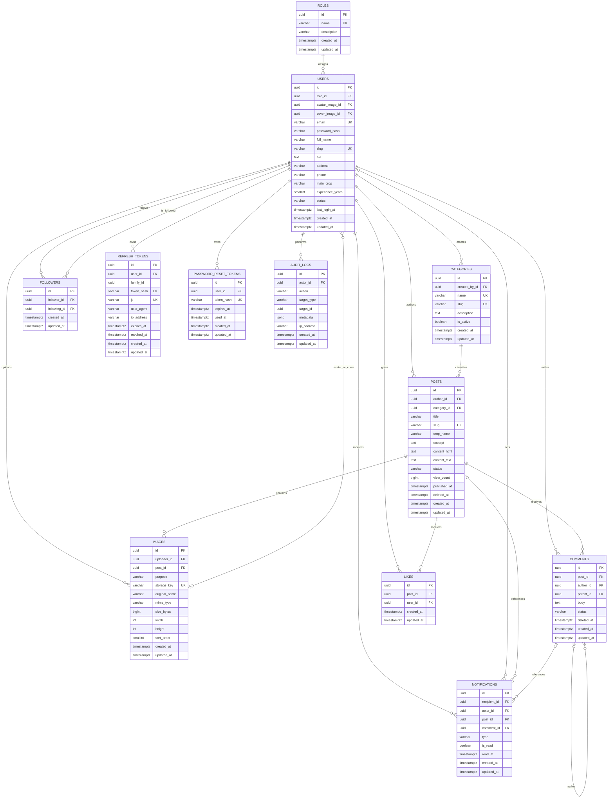

# 04. ERD và từ điển dữ liệu

## 1. Nguyên tắc thiết kế

- Khóa chính dùng UUID để tránh lộ số lượng bản ghi và thuận lợi khi phân tán.
- Mọi quan hệ nghiệp vụ đều có foreign key thật; không tạo foreign key giả cho bảng gốc như `roles` chỉ để “đủ cột”.
- Mọi bảng có `created_at`, `updated_at`; thời gian lưu UTC và chuyển múi giờ ở giao diện.
- Tên bảng/cột trong database dùng `snake_case`; JSON API dùng `camelCase`.
- Dùng unique/check constraint để bảo vệ quy tắc ngay cả khi API bị gọi đồng thời.
- Bài và bình luận xóa mềm; token hết hạn/thu hồi được lưu để audit và chống tái sử dụng.

## 2. ERD

## 3. Từ điển dữ liệu

Các cột `id`, `created_at`, `updated_at` có ở mọi bảng. Bảng dưới mô tả các cột nghiệp vụ và constraint quan trọng.

### `roles`

| Cột | Kiểu | Null | Ràng buộc / ý nghĩa |
|---|---|---:|---|
| id | uuid | Không | PK |
| name | varchar(30) | Không | Unique; `MEMBER`, `ADMIN` |
| description | varchar(255) | Có | Mô tả vai trò |

`roles` là bảng danh mục gốc nên không có foreign key. Thêm một FK không có quan hệ thực sẽ làm sai mô hình chuẩn hóa.

### `users`

| Cột | Kiểu | Null | Ràng buộc / ý nghĩa |
|---|---|---:|---|
| role_id | uuid | Không | FK → roles.id, restrict delete |
| avatar_image_id | uuid | Có | FK → images.id, set null |
| cover_image_id | uuid | Có | FK → images.id, set null |
| email | varchar(255) | Không | Unique trên email chuẩn hóa |
| password_hash | varchar(255) | Không | Hash Argon2id, không trả qua API |
| full_name | varchar(100) | Không | Tên hiển thị |
| slug | varchar(120) | Không | Unique, URL hồ sơ |
| bio | text | Có | Tối đa 1000 ký tự |
| address | varchar(255) | Có | Địa chỉ tự khai báo |
| phone | varchar(20) | Có | Chuẩn hóa; mặc định không công khai |
| main_crop | varchar(100) | Có | Cây trồng chính của hồ sơ |
| experience_years | smallint | Có | Check từ 0 đến 100 |
| status | varchar(20) | Không | `ACTIVE`, `BLOCKED` |
| last_login_at | timestamptz | Có | Lần đăng nhập gần nhất |

### `categories`

| Cột | Kiểu | Null | Ràng buộc / ý nghĩa |
|---|---|---:|---|
| created_by_id | uuid | Có | FK → users.id, set null; seed ban đầu có thể null |
| name | varchar(100) | Không | Unique |
| slug | varchar(120) | Không | Unique |
| description | text | Có | Mô tả |
| is_active | boolean | Không | Mặc định true |

### `posts`

| Cột | Kiểu | Null | Ràng buộc / ý nghĩa |
|---|---|---:|---|
| author_id | uuid | Không | FK → users.id, restrict delete |
| category_id | uuid | Không | FK → categories.id, restrict delete |
| title | varchar(200) | Không | Tiêu đề bài |
| slug | varchar(240) | Không | Unique; sinh từ tiêu đề + suffix |
| crop_name | varchar(100) | Có | Cây trồng đề cập trong bài, dùng lọc |
| excerpt | varchar(500) | Có | Mô tả ngắn |
| content_html | text | Không | HTML đã sanitize |
| content_text | text | Không | Plain text phục vụ search/preview |
| status | varchar(20) | Không | `DRAFT`, `PUBLISHED`, `HIDDEN`, `DELETED` |
| view_count | bigint | Không | Mặc định 0, không âm |
| published_at | timestamptz | Có | Bắt buộc khi `PUBLISHED` |
| deleted_at | timestamptz | Có | Xóa mềm |

### `images`

| Cột | Kiểu | Null | Ràng buộc / ý nghĩa |
|---|---|---:|---|
| uploader_id | uuid | Không | FK → users.id, restrict delete |
| post_id | uuid | Có | FK → posts.id, set null trong giai đoạn chờ dọn file |
| purpose | varchar(20) | Không | `POST`, `AVATAR`, `COVER` |
| storage_key | varchar(500) | Không | Unique, tên UUID/path nội bộ |
| original_name | varchar(255) | Không | Chỉ metadata, không dùng làm path |
| mime_type | varchar(50) | Không | JPEG/PNG/WebP theo allowlist |
| size_bytes | bigint | Không | Check 0 < size ≤ 5 MB |
| width, height | integer | Có | Kích thước ảnh sau khi đọc metadata |
| sort_order | smallint | Không | Mặc định 0; thứ tự trong bài |

### `comments`

| Cột | Kiểu | Null | Ràng buộc / ý nghĩa |
|---|---|---:|---|
| post_id | uuid | Không | FK → posts.id, restrict delete |
| author_id | uuid | Không | FK → users.id, restrict delete |
| parent_id | uuid | Có | Self FK → comments.id, restrict delete |
| body | text | Không | Plain text, 1–2000 ký tự |
| status | varchar(20) | Không | `VISIBLE`, `HIDDEN`, `DELETED` |
| deleted_at | timestamptz | Có | Xóa mềm |

Service phải xác minh comment cha thuộc cùng `post_id` và không tạo độ sâu ngoài chính sách hiển thị.

### `likes`

| Cột | Kiểu | Null | Ràng buộc / ý nghĩa |
|---|---|---:|---|
| post_id | uuid | Không | FK → posts.id, cascade khi hard-delete có kiểm soát |
| user_id | uuid | Không | FK → users.id, restrict delete |

Unique `(post_id, user_id)` ngăn thích trùng.

### `followers`

| Cột | Kiểu | Null | Ràng buộc / ý nghĩa |
|---|---|---:|---|
| follower_id | uuid | Không | FK → users.id |
| following_id | uuid | Không | FK → users.id |

Unique `(follower_id, following_id)` và check `follower_id <> following_id`.

### `notifications`

| Cột | Kiểu | Null | Ràng buộc / ý nghĩa |
|---|---|---:|---|
| recipient_id | uuid | Không | FK → users.id, người nhận |
| actor_id | uuid | Có | FK → users.id, set null nếu ẩn danh hóa |
| post_id | uuid | Có | FK → posts.id, set null |
| comment_id | uuid | Có | FK → comments.id, set null |
| type | varchar(30) | Không | `POST_LIKED`, `POST_COMMENTED`, `COMMENT_REPLIED`, `USER_FOLLOWED` |
| is_read | boolean | Không | Mặc định false |
| read_at | timestamptz | Có | Đồng bộ với `is_read` |

Check bảo đảm trường tham chiếu phù hợp loại thông báo khi có thể.

### `refresh_tokens`

| Cột | Kiểu | Null | Ràng buộc / ý nghĩa |
|---|---|---:|---|
| user_id | uuid | Không | FK → users.id, cascade khi hard-delete |
| family_id | uuid | Không | Nhận diện chuỗi token để phát hiện reuse |
| token_hash | varchar(255) | Không | Unique; không lưu raw token |
| jti | varchar(100) | Không | Unique token identifier |
| user_agent | varchar(500) | Có | Thông tin phiên |
| ip_address | varchar(45) | Có | IPv4/IPv6, hạn chế dữ liệu log |
| expires_at | timestamptz | Không | Hạn token |
| revoked_at | timestamptz | Có | Thời điểm thu hồi |

### `password_reset_tokens`

| Cột | Kiểu | Null | Ràng buộc / ý nghĩa |
|---|---|---:|---|
| user_id | uuid | Không | FK → users.id, cascade khi hard-delete |
| token_hash | varchar(255) | Không | Unique, token một lần |
| expires_at | timestamptz | Không | Thời hạn ngắn |
| used_at | timestamptz | Có | Không null sau khi dùng |

### `audit_logs`

| Cột | Kiểu | Null | Ràng buộc / ý nghĩa |
|---|---|---:|---|
| actor_id | uuid | Không | FK → users.id, restrict delete |
| action | varchar(100) | Không | Ví dụ `USER_BLOCKED`, `POST_HIDDEN` |
| target_type | varchar(50) | Không | Loại đối tượng |
| target_id | uuid | Không | ID đối tượng; không FK đa hình |
| metadata | jsonb | Có | Lý do và snapshot tối thiểu, không chứa secret |
| ip_address | varchar(45) | Có | Nguồn hành động |

`target_id` không thể là foreign key tới nhiều bảng. Tính hợp lệ được service bảo đảm; `actor_id` vẫn là foreign key.

## 4. Chỉ mục và constraint chính

| Bảng | Index / Constraint |
|---|---|
| users | unique lower(email), unique slug, index `(status, created_at)` |
| posts | unique slug, index `(status, published_at desc)`, `(author_id, status)`, `category_id`, normalized `crop_name` |
| comments | `(post_id, created_at)`, `author_id`, `parent_id`, `status` |
| likes | unique `(post_id, user_id)`, index `user_id` |
| followers | unique `(follower_id, following_id)`, index `(following_id, created_at)` |
| notifications | `(recipient_id, is_read, created_at desc)` |
| images | unique storage_key, `(post_id, sort_order)`, `uploader_id` |
| tokens | unique token_hash/JTI; `(user_id, revoked_at, expires_at)` |

## 5. Dữ liệu seed tối thiểu ở Giai đoạn 2

- Roles: `ADMIN`, `MEMBER`.
- Categories: Kỹ thuật trồng trọt, Phòng trừ sâu bệnh, Đất và dinh dưỡng, Tưới tiêu, Thu hoạch và bảo quản, Nhật ký mùa vụ.
- Một admin khởi tạo từ biến môi trường/seed an toàn; không hard-code mật khẩu trong repository.

## 6. Lưu ý migration

Quan hệ vòng tùy chọn giữa `users` và `images` được tạo theo hai bước: tạo `users` chưa có FK avatar/cover, tạo `images`, sau đó thêm hai FK nullable. Stage 2 phải có migration rollback và test constraint trước khi triển khai authentication.
